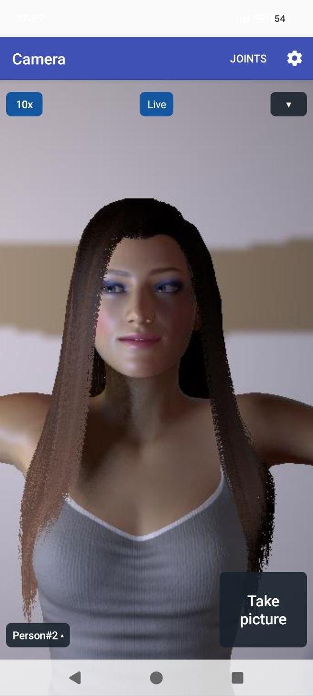
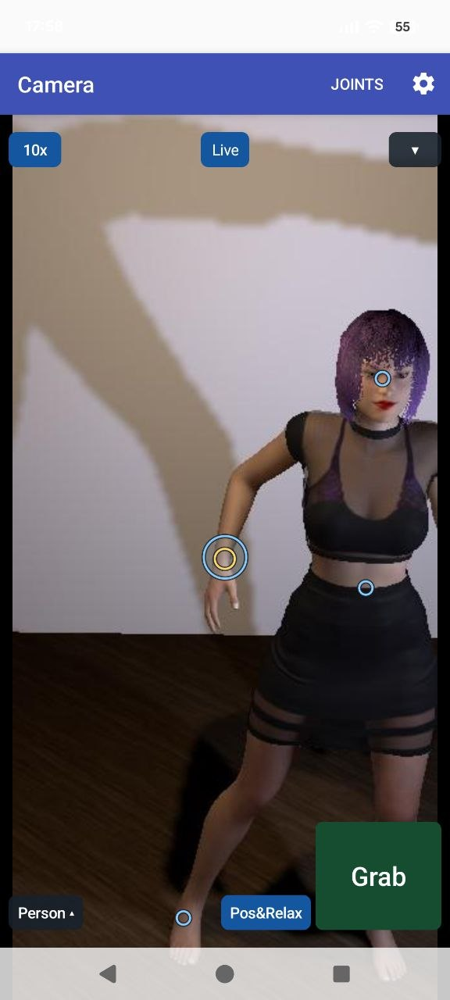
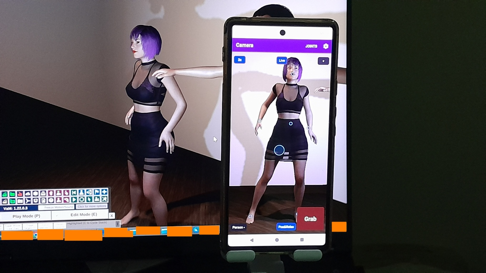
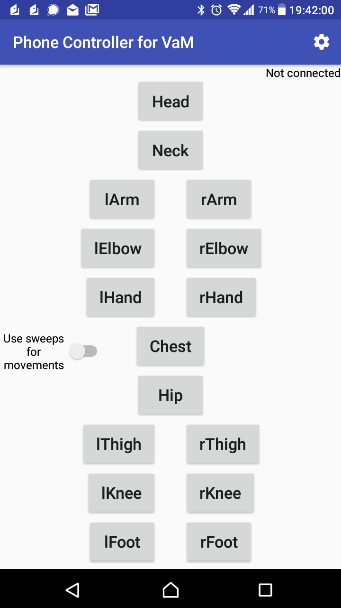

# PhoneControllerForVaM

(this project was created with help of AI assistant)

This plugin lets you use your Android phone with VaM. 
All the functionality is set up around a virtual camera which moves inside VaM space as you move your phone around.
Your phone will ask as a **Virtual Camera** from inside the VaM.

This is done by using Google's new positioning API for Android phones -- ARCore. It fuses together data from accelerometer, gyrometer, magnetic compas, and camera movement to figure out precise phone position in space. 
It works just like VR headset's inside-out tracking, but with a single camera. (look up **ARCore demo** at youtube).

I tested it on Pixel 6.

## Installation

Download .var file of version 0.4 from this page: <https://github.com/Eugene-E0a80fd8080ff8e/PhoneControllerForVaM/releases> .
Put this file in your VaM's **AddonPackages** folder.

From the same page, download .apk file and install it on your phone. You may scroll down to **Installation and set up** for some instruction. 
The actual procedure of installing an .apk file might differ from brand to brand and from android version to version.

If something goes wrong -- ask ChatGPT, Grok or Gemini (or an AI of your like), providing it with the link to this page and explain your intention and a problem.

## Network setup

In short: 
 - the VaM plugin opens UDP port 62701 for listening and sets up a beacon on the same port broadcasting "I am here" every 300ms, expecting to be replied back into that port.
 - Android app looks for that broadcasts and communicates back.

This plugin is designed to work inside your local network. In simple words, connect both your computer and the phone to the same Wi-Fi router. 
Make sure your devices are allowed to see each other over the local network -- normally it is so, unless you have some obscure privacy/security settings enabled.

Make sure your computer allowed to open ports and send trattic into this network. On windows you need to set your network to be Private Network (nomally it is alread so, as it is required to interact with printers, TVs, VR HMD's, etc)

On linux, be reminded that **ufw status** and maybe do **sudo ufw allow 62701/udp** if needed.

## UI

Add the plugin to Scene atom, Session Atom or Person atom. The is a single .cslist file inside the .var -- add it.

1. **Scale** changes the ratio of mapping between your physical world and inner world of VaM.

2. Top-right controls: **Hold** -- holds virtual camera in one place, disconnects in from the phone movement; camera will keep updating. **Frame** -- moves the camera (changes world mapping so that your camera looks at) to look at the selected object.

3. Bottom-left: changes currently selected object.

4. Bottom-right: depending on yours settings, there might be buttons "Grab", 'Take picture".

4.1. **Take picture** -- takes a picture and saves it to the gallery of your phone. This button is disabled in settings by default.

4.2. **Grab** -- allows grabbing and moving. Moves joints for a person; moves root for an object. 
 - **pos** -- moves position, keeps rotation as is
 - **rot** -- moves rotation, keeps position as is
 - **pos&rot** -- moves both
 - **pos&relax** -- moves position, sets rotation to "off" while in move, so rotation is defined by VaM's physics engine. (default)
 - **head only** -- grabs head and sets other controllers to "off" state. Lets you move a person just like a chess figure.

## Future plans

1. Maybe add a collider in front of the camera for inetractive-like experience ? (removable in settings page)

2. POV mode for Person Atom or any other atom ? 

# Legacy PhoneControllerForVaM

This functions are still available in this updated version. You can switch to it by clicking "JOINTS" at the top bar.

This plugin lets you use your phone as a 3-DoF VR controller in Virt-a-Mate. 
You press a button on your phone to select a limb or the head.
Then you rotate it in any directions with your phone.

Optional position tracking uses ARCore and the phone camera to move hands and feet. Rotation remains available without ARCore.

# Prerequisites

1. An **Android phone** running Android 7.0 or later. Position tracking additionally requires an ARCore-supported device.

2. A local network (**Wi-Fi**), to which both phone and computer should be connected. 
Network should be configured in a way that phone and computer could see each other. 
It is a usual configuration for home networks.

# Installation and set up

### First, lets install the app on the phone. 

1. On your phone, open **Settings → Lock screen & security**. Find **Unknown sources** 
and flip the switch to the **On** state.

   At this point the app is not published at Google Play Store. It is just too early. 
The only way to install it is through the third-party installation process.
By default such process is disabled due to security consideration.
This program is provided in open sources and this lets you review the source code either youself 
or with somebody's help.

2. Open this page in a browser of your phone.

   Follow this link on your phone: <https://github.com/Eugene-E0a80fd8080ff8e/PhoneControllerForVaM/releases>

   On the page there will be list of releases. 
   Most recent one would be on top. 
   Click on *PhoneControllerForVaM.apk* to download the apk file (the file which contains the app). 
   This will open the folder with app file in it.

3. Once it is downloaded, open the file and confirm the installation.

   Open the app. It will be at the end of Apps list.

4. Once app is opened, you need to set it up.

   Click settings button at the top-right corner of the app.
Make sure there is a green message saying that magnetometer is calibrated properly (3/3). 
If it says the opposite, swing the phone in the air in the form of figure 8 (eight) couple times. 
If phone is not willing to calibrate, check if you have stong magnets on your table, or a speaker, 
or maybe you have a cover with magnetic clip on your phone.

   Once magnetometer is calibrated, point it to your phone as if you were making a nicely aligned 
picture of something on your monitor. Once magnetic direction stabilizes, click **Use this direction**.

   Press the back button.

5. Make sure your phone is connected to the Wi-Fi network and it is the same network your computer is connected to.

6. You are finished with the phone setup!

### Second, lets install the plugin for VaM.

1. On release page(<https://github.com/Eugene-E0a80fd8080ff8e/PhoneControllerForVaM/releases>) find **PhoneController.cs** file. Click on it to download it.

   Save the file to **_Your-VAM-Folder_/Custom/Scripts/** folder.

2. Open Virt-a-Mate, choose a model, opens its menu and select **Plugins** section. 

   Click **Add Plugin**. A new section will appear at the end of a list. Click **Select File...** and 
select the previously downloaded file.

   At this point The Windows Firewall might appear and ask you if you allow this application to use local network. Confirm it.

3. It should work by now.
   While using it, keep your eye on «Magnetometer not calibrated» message. If you see it, swing your phone to calibrate it. 
   (Here is no need to go to direction settings page)

### Usage

With position tracking off, press and hold a body-part button and rotate the phone to rotate that control. Toggle mode is available in controller settings.

To move a hand or foot in position as well:

1. Install the current Android app and the matching updated VaM plugin.
2. Enable **Position tracking**, grant camera access, and install or update Google Play Services for AR if prompted. This requires an ARCore-supported phone, Android 7 or newer, and a well-lit, visually detailed environment.
3. Wait for **Position: tracking**. Point the phone toward the monitor as in the direction setup, then press and hold a hand or foot button and move the phone. Release and press again to start from a new reference. Rotation remains active.
4. If tracking is lost, release the button and wait for tracking to recover before pressing again. Position updates also stop when the app is backgrounded or the connection times out.

ARCore uses the camera on the phone; camera images are not sent to VaM. Tracking may drift or stop when the view is dark, featureless, covered, or moving too quickly. Monitor alignment and movement directions should be checked in the intended setup before use.

A configuration with more than one server or more than one client per local network was considered during development but was never tested.

Feedback on the plugin and the app would be appreciated.

Also, let me know if I can improve this instruction. Did I miss something?

